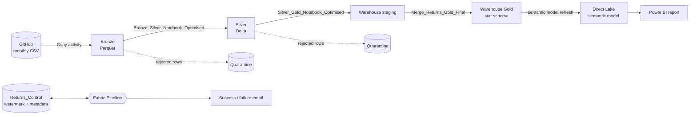
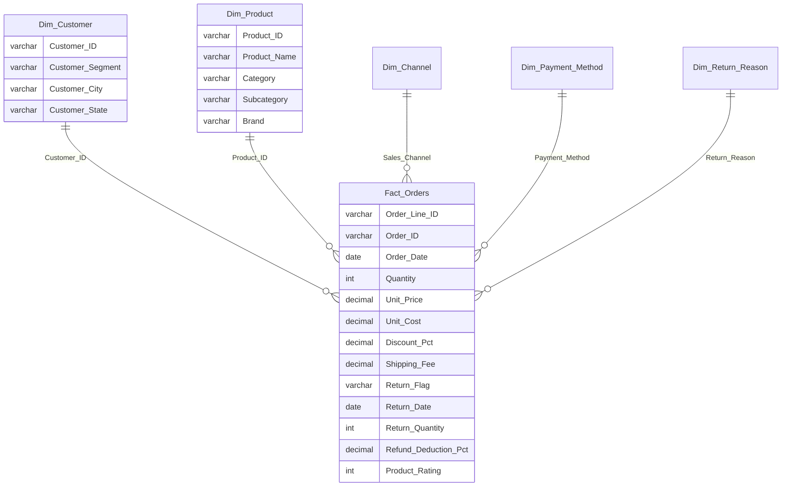

# Incremental Returns Analytics Lakehouse on Microsoft Fabric


An end-to-end, month-by-month data pipeline on Microsoft Fabric. It loads e-commerce order and returns files from GitHub, cleans and validates them through a **Bronze → Silver → Gold** medallion architecture, and publishes a star schema in a Fabric Warehouse for returns and refund analysis. Bad rows are quarantined with reasons, every run is audited, and success or failure is emailed without Microsoft 365.

**Author:** Adarsh Damarla<br>
**Platform:** Microsoft Fabric (Lakehouse, Warehouse, Data Pipeline, Notebooks, Power BI)<br>
**Status:** Complete for the 2025 dataset (12 monthly files)

## Table of Contents

- [Project Highlights](#project-highlights)
- [Architecture](#architecture)
- [Data Flow](#data-flow)
- [Dimensional Model](#dimensional-model)
- [Implemented Fabric Resources](#implemented-fabric-resources)
- [Power BI Semantic Model and Report](#power-bi-semantic-model-and-report)
- [Project Structure](#project-structure)
- [Running the Pipeline](#running-the-pipeline)
- [Engineering Decisions](#engineering-decisions)
- [Fault Tolerance](#fault-tolerance)
- [Challenges Solved](#challenges-solved)
- [Validation](#validation)
- [Documentation](#documentation)
- [Technology Stack](#technology-stack)
- [Scope and Future Evolution](#scope-and-future-evolution)
- [Author](#author)

## Project Highlights

- **Incremental by month.** A watermark table tracks the last month loaded; each run picks up the next month automatically, and any month can be reprocessed through pipeline parameters.
- **Medallion architecture.** Raw Parquet in Bronze, validated Delta in Silver, a star schema in the Warehouse.
- **Quarantine, not rejection.** Rows that break a rule are written to a quarantine location with every failed rule listed, and the rest of the month still loads.
- **Idempotent loads.** Silver and Gold are upserts on `Order_Line_ID`; staging and quarantine are overwritten, so reruns never duplicate data.
- **All-or-nothing Gold merge.** The six Gold merges run in one transaction and roll back on any error.
- **Run auditing.** Every run writes row counts, duration, status and error text to `Returns_Control.Pipeline_Metadata`.
- **Direct Lake reporting.** A Power BI semantic model reads the Gold tables directly from OneLake in Direct Lake mode, with no data import. The pipeline refreshes the model as its last data step, so the report shows each month's load as soon as the run ends.
- **Email alerts without Microsoft 365.** A Fabric Web activity posts the result to a Google Apps Script web app, which sends a `[SUCCEEDED]` or `[FAILED]` email.

## Architecture



The pipeline is the single orchestrator: it decides which month to load from the watermark, runs each stage in order, refreshes the semantic model, records the outcome, and sends the email. Processing is batch, one month per run. Full activity-by-activity detail is in the [architecture document](docs/PIPELINE_ARCHITECTURE.md).

## Data Flow

| Layer | Location | Format | Processing | Purpose |
|---|---|---|---|---|
| Source | `Data/*.csv` on GitHub | CSV | None | One file per month, one row per order line |
| Bronze | Lakehouse `Files/bronze/ecommerce_returns/year=/month=/` | Parquet (snappy) | Copy activity over HTTP | Raw copy of the month |
| Silver | Lakehouse `Files/silver/ecommerce_returns/` | Delta, partitioned by year and month | Type casting, standardization, validation, upsert | Clean, typed order lines |
| Quarantine | Lakehouse `Files/quarantine/ecommerce_returns/` | Delta | Rows that failed a rule, with reasons | Review and reprocess |
| Staging | Warehouse `Returns_Staging` | `*_stg` tables | Overwritten each run, row counts verified | Landing area for the merge |
| Gold | Warehouse `Returns_Gold` | Tables | Transactional MERGE | Star schema for reporting |
| Control | Warehouse `Returns_Control` | Tables | Watermark and run log | Incremental loading and audit |
| Notebook audit | Lakehouse tables `audit_bronze_silver`, `audit_silver_gold` | Delta | One row appended per notebook run, one table per notebook | Row counts and status per layer |

## Dimensional Model



`Fact_Orders` has one row per order line. The model joins on natural business keys, with no surrogate keys. `Dim_Product` and `Dim_Customer` are **Type 1**: a changed attribute overwrites the old value. `Dim_Channel`, `Dim_Payment_Method` and `Dim_Return_Reason` are single-column lookup lists that only receive new values.

## Implemented Fabric Resources

| Item | Name | Purpose |
|---|---|---|
| Lakehouse | `Ecommerce_Returns_Lakehouse` | Bronze, Silver and quarantine files |
| Warehouse | `Ecommerce_Returns_Warehouse` | Staging, Gold and control schemas |
| Data pipeline | `Ecommerce_Returns_Pipeline` | Orchestration, watermark, semantic model refresh, error handling, email |
| Notebook | `Bronze_Silver_Notebook_Optimised` | Clean, validate and merge into Silver |
| Notebook | `Silver_Gold_Notebook_Optimised` | Validate, build facts and dimensions, load staging |
| Stored procedure | `Returns_Staging.Merge_Returns_Gold_Final` | Transactional merge into Gold |
| Stored procedure | `Returns_Control.Update_Watermark` | Moves the watermark forward only |
| Stored procedure | `Returns_Control.Insert_Pipeline_Metadata` | Writes the run log |
| Semantic model | `Ecommerce_Returns_Semantic_Model` | Direct Lake model on the Gold schema, with relationships and DAX measures; refreshed by the pipeline |
| Report | `Ecommerce_Returns_Report` | Three-page Power BI report on the semantic model |
| Connection | HTTP (GitHub raw) | Source of the monthly files |
| Connection | Web v2 (Apps Script) | Sends the email |
| Connection | Power BI semantic model | Lets the pipeline refresh the semantic model |

## Power BI Semantic Model and Report

The Gold star schema is exposed to Power BI through a semantic model and a report. Both live in the `Fabric_Ecommerce_Return_Analysis` folder, so they are versioned with the rest of the Fabric items through Git integration.

### Semantic model: `Ecommerce_Returns_Semantic_Model`

Every table uses **Direct Lake** storage mode and points at the `Returns_Gold` schema of `Ecommerce_Returns_Warehouse` through OneLake. There is no data import: the model reads the Delta files behind the Gold tables. After the watermark is updated, the pipeline runs a **semantic model refresh** activity (`Ecommerce_Returns_Sematic_Model`) that waits for completion (20 minute timeout, 1 retry). For a Direct Lake model a refresh reframes the model onto the latest Delta data rather than copying it, so it is quick. Only the Gold tables are in the model; the staging and control tables are left out.

| Table | Role | Relationship to `Fact_Orders` |
|---|---|---|
| `Fact_Orders` | Fact, one row per order line, holds all measures | |
| `Dim_Customer` | Dimension | `Customer_ID` |
| `Dim_Product` | Dimension | `Product_ID` |
| `Dim_Channel` | Dimension | `Sales_Channel` |
| `Dim_Payment_Method` | Dimension | `Payment_Method` |
| `Dim_Return_Reason` | Dimension | `Return_Reason` |
| `Dim_Date` | Calendar (`Date`, `Year`, `Month Number`, `Month`, `Year Month`) | `Order_Date` (active) and `Return_Date` (inactive) |

`Dim_Date` is the one Gold table the monthly pipeline does not load. It is a fixed calendar (one row per day from 2020-01-01 to 2035-12-31) created once by [`Warehouse_Setup/10_Create_Dim_Date.sql`](Warehouse_Setup/10_Create_Dim_Date.sql), which is safe to re-run. Order and return dates must fall inside that range. The role-playing date is handled with an inactive `Return_Date` relationship that the `Refund Amount by Return Date` measure activates through `USERELATIONSHIP`. All relationships are many-to-one, single direction.

**Measures** are defined on `Fact_Orders` and grouped into display folders. Amounts are formatted in rupees, matching the source data.

| Folder | Measures |
|---|---|
| Volume | Order Lines, Orders, Units Sold, Customers |
| Sales | Gross Sales, Discount Amount, Net Sales, Shipping Fees, Avg Order Value, Net Sales Previous Month, Net Sales MoM % |
| Returns | Returned Lines, Returned Units, Refund Amount, Refund Amount by Return Date, Return Rate (Lines), Return Rate (Units), Refund % of Net Sales, Avg Days to Return |
| Profit | Net Sales After Returns, Cost of Kept Units, Gross Profit, Gross Margin % |
| Service | Avg Rating, Avg Days to Deliver |

Key definitions:

- **Net Sales** = Gross Sales (`Quantity x Unit_Price`) minus the discount amount (`Discount_Pct`).
- **Refund Amount** = `Return_Quantity x Unit_Price`, reduced by the order discount and by `Refund_Deduction_Pct`.
- **Gross Profit** = Net Sales minus Refund Amount minus the cost of the units that were kept (`Unit_Cost x (Quantity - Return_Quantity)`).
- **Return Rate** is shown by order lines and by units.

Implicit measures are disabled (`discourageImplicitMeasures`), so report authors use the defined measures rather than summing raw columns.

### Refresh in the pipeline

`Ecommerce_Returns_Sematic_Model` (the activity name is spelled this way in the pipeline) runs only after `Stored_Procedure_Update_Watermark` succeeds, so a month is never published to the report unless Gold loaded. It is part of the error handling like every other stage: a failure is captured as `Ecommerce_Returns_Sematic_Model Failed: <error>`, logged in `Pipeline_Metadata`, emailed, and the pipeline ends as failed. Because it runs after the watermark moves, a refresh failure does not undo the load: Gold and the watermark are already updated, and the next run continues with the following month. Re-run the refresh from the Fabric workspace, or reprocess the month with the pipeline parameters, to bring the report up to date.

### Report: `Ecommerce_Returns_Report`

The report is bound to the semantic model by relative path (`definition.pbir`) and has three pages, each with KPI cards and slicers:

| Page | Focus | Visuals |
|---|---|---|
| Overview | Sales and returns at a glance | Cards, line, column, bar and donut charts |
| Returns analysis | Return rate, refunds and reasons | Cards, line, column and bar charts |
| Customers and products | Who and what drives orders and returns | Cards, bar charts and a detail table |

### Working with the model

The model and report are stored in Fabric's text formats (TMDL for the model, PBIR for the report), so changes show up as readable diffs in Git. Edit them in the Fabric workspace and let Git integration commit the change, or open the folders in Power BI Desktop developer mode. The Gold tables, including `Dim_Date`, must exist and contain data before the model is opened or refreshed.

## Project Structure

```
.
├── README.md
├── Warehouse_Setup/                    Numbered T-SQL scripts to build the warehouse objects (including the Dim_Date calendar)
├── apps_script/
│   └── Code.gs                         Google Apps Script that sends the pipeline emails
├── LICENSE                             MIT
├── docs/
│   ├── PIPELINE_ARCHITECTURE.md        Activities, layers, watermark logic, repo layout
│   ├── BUSINESS_RULES.md               Cleaning, validation, quarantine and merge rules
│   ├── EMAIL_NOTIFICATIONS.md          Web activity + Apps Script email setup
│   ├── SEMANTIC_MODEL.md               Direct Lake model: tables, relationships, measures
│   ├── POWER_BI_REPORT.md              Report pages, visuals and fields
│   └── SCHEMA_CHECK_DEMO.md            Demo of the schema drift and missing-column alerts
├── Data/
│   ├── Ecommerce_Returns_Refunds_2025_01_January.csv ... _2025_12_December.csv
│   └── Ecommerce_Returns_Refunds_2024_01_January.csv, _2024_02_February.csv   Demo files that fail the schema checks on purpose
└── Fabric_Ecommerce_Return_Analysis/   Fabric Git integration root
    ├── Ecommerce_Returns_Lakehouse.Lakehouse/
    ├── Ecommerce_Returns_Pipeline.DataPipeline/
    │   └── pipeline-content.json       All activities, variables, parameters
    ├── Notebooks/
    │   ├── Bronze_Silver_Notebook_Optimised.Notebook/   Used by the pipeline
    │   ├── Silver_Gold_Notebook_Optimised.Notebook/     Used by the pipeline
    │   ├── Bronze_Silver_Notebook.Notebook/             Earlier version, not used
    │   └── Silver_Gold_Notebook.Notebook/               Earlier version, not used
    ├── Ecommerce_Returns_Semantic_Model.SemanticModel/   Direct Lake model (TMDL): tables, relationships, measures
    ├── Ecommerce_Returns_Report.Report/                  Power BI report (PBIR): three pages
    └── Ecommerce_Returns_Warehouse.Warehouse/
        ├── Returns_Control/            Watermark + metadata tables and procedures
        ├── Returns_Staging/            *_stg tables and the Gold merge procedure
        ├── Returns_Gold/               Fact and dimension tables
        └── Security/                   Schema definitions
```

## Running the Pipeline

**Normal run (next month automatically):** run or schedule `Ecommerce_Returns_Pipeline` with both parameters empty.

**Reprocess a specific month:** set both `reprocess_year` and `reprocess_month`, for example `2025` and `3`. Set both or neither: if only one is set, both are ignored. The watermark never moves backwards, so reprocessing an older month does not disturb it.

**First run:** build the warehouse objects with the numbered scripts in [`Warehouse_Setup`](Warehouse_Setup/README.md) (schemas, tables, procedures, the starting watermark and the `Dim_Date` calendar), then run the pipeline. Further steps are in the [architecture document](docs/PIPELINE_ARCHITECTURE.md#setup-notes).

**Source data:** one CSV per month named `Ecommerce_Returns_Refunds_<YYYY>_<MM>_<MonthName>.csv`. Amounts carry a rupee sign and thousands separators (`₹3,355.27`) and dates use `dd-MMM-yyyy`; the Silver notebook normalizes both.

## Engineering Decisions

### Why a watermark instead of a schedule-based date?
The source is a monthly file, and the right month to load depends on what has already succeeded, not on the calendar. The watermark moves only after the Gold merge succeeds, so a failed run retries the same month on the next run.

### Why quarantine bad rows instead of failing the run?
One malformed row should not block a whole month of good data. Each rejected row keeps its original values and the full list of failed rules, so it can be fixed at the source and reprocessed. A run fails only for structural problems (missing file, missing mandatory columns, new unexpected columns, invalid parameters) or when more than 5% of a month's rows are quarantined (`p_max_reject_pct`), which usually points to a broken source file.

### Why validate twice (Bronze to Silver, then Silver to Gold)?
The first pass cleans raw text and enforces data quality. The second protects the warehouse: it re-checks the fields reporting depends on, builds the dimensions, and confirms staging row counts before anything reaches Gold.

### Why staging tables and a MERGE into Gold?
Staging is overwritten each run and verified by row count, so Gold only ever receives a checked batch. The MERGE makes reruns safe, and wrapping the six merges in one transaction means Gold is either fully updated or unchanged.

### Why Delta files for Silver instead of loading straight to the Warehouse?
Delta gives upserts, schema handling and partitioning by year and month in the Lakehouse, and keeps a re-readable history of cleaned data that does not depend on the Warehouse being available.

### Why Google Apps Script for email?
The built-in Office 365 Outlook activity needs a Microsoft 365 mailbox. A Web activity calling an Apps Script web app sends the same alerts from a free Gmail account, with no extra Azure resources.

## Fault Tolerance

| Situation | Behaviour |
|---|---|
| Bad rows (invalid IDs, dates, amounts, values, rule breaks) | Quarantined with the reasons; the rest of the month loads |
| Too many bad rows (more than 5% of a month, usually a broken source file) | The notebook fails before loading: Silver or staging is not touched, the quarantine is kept for inspection, the failure email is sent and the watermark does not advance |
| Missing or new columns in the source file | A missing mandatory column or a new (unexpected) column fails the run before anything is loaded; a missing non-mandatory column is filled with NULL |
| Empty Bronze month | The notebook exits cleanly with 0 rows |
| Duplicate rows or duplicate `Order_Line_ID` values | Exact duplicates removed; extra keys quarantined so merges never fail on duplicate keys |
| Temporary failure of a stage | Main activities retry once after 30 seconds |
| Semantic model refresh fails | Runs after Gold and the watermark are updated, so the data is safe; the failure is logged, emailed and fails the pipeline, and the report keeps showing the previous month until the refresh is re-run |
| A stage that still fails | The error is captured, the run is logged to `Pipeline_Metadata`, an email is sent, and the pipeline fails with the real error |
| Failure during the Gold merge | The six merges run in a single transaction, so Gold is either fully updated or left unchanged |
| Failed or partial run | The watermark moves only after the Gold merge succeeds, so the next run retries the same month |
| Rerunning a month | Safe: Silver and Gold are upserts on `Order_Line_ID`; staging and quarantine are overwritten |
| Staging write problems | Each staging table is read back and its row count checked before the merge |

It does not recover by itself once the retry is used up: a failed stage stops the run and needs a fix and a rerun. A missing source file also counts as a failure and sends the alert.

## Challenges Solved

| Challenge | Solution |
|---|---|
| Amounts like `₹3,355.27` and dates like `27-Jan-2025` arrive as text | Strip non-numeric characters, cast to decimals, parse `dd-MMM-yyyy` explicitly |
| Inconsistent labels (`UPI`, `wallet`, `COD`, `Not As Expected`) | Standardize case and map known variants before validating against allowed values |
| Returns data that contradicts itself (a return date on a non-returned order, return quantity above quantity) | Cross-field rules tie `Return_Flag`, `Return_Date`, `Return_Reason` and quantities together |
| The same `Order_Line_ID` appearing twice breaks a MERGE | Keep the best row per key and quarantine the rest before the merge |
| Source columns added or removed between files | Fail on a new column (schema drift) or a missing mandatory column; fill other missing columns with NULL |
| Reruns must not duplicate data | Upserts on the business key; overwrite for staging and quarantine |
| A failure halfway through the Gold merge | One transaction with rollback, and the error re-raised to the pipeline |
| Knowing what happened in each run | Per-stage error messages and a metadata row for every run |
| No Microsoft 365 for pipeline email | Web activity + Google Apps Script, with Gmail filters for labelling |
| A next month that has no file yet | Detected as `No Source File`; watermark not advanced |

## Validation

- **Per-run audit:** every run adds a row to `Returns_Control.Pipeline_Metadata` with Bronze, Silver, Gold-staging and Gold-final row counts, duration and status.
- **Notebook audit:** each notebook appends a row to its own Lakehouse table (`audit_bronze_silver`, `audit_silver_gold`) with its row counts, status (`Success`, `No Data` or `Rejected`) and duration; the Bronze table also has inserted/updated counts and the Gold table has one count per staging table. Pass `@pipeline().RunId` as `p_run_id` to join it to `Pipeline_Metadata`.
- **Staging read-back:** each `*_stg` table is counted after writing and compared with the expected count.
- **Quarantine summary:** the notebooks print the number of rejected rows and a count per failed rule.
- **Email:** the success email carries the processed month and row counts; the failure email carries the error text.
- **Schema checks:** a new column in the source file (schema drift) or a missing mandatory column fails the run before anything is loaded. Two demo files in `Data/` (`Ecommerce_Returns_Refunds_2024_01_January.csv` and `..._2024_02_February.csv`) reproduce both cases through the normal pipeline; see the [demo guide](docs/SCHEMA_CHECK_DEMO.md).

Example check of recent runs:

```sql
SELECT TOP 12
    Process_Year, Process_Month_Name, Load_Status,
    Bronze_Record_Processed, Silver_Record_Processed,
    Gold_Fact_Stg_Record_Processed, Gold_Fact_Final_Record_Count,
    Duration_Seconds, Error_Message
FROM Returns_Control.Pipeline_Metadata
ORDER BY Start_Time DESC;
```

## Documentation

| Document | What it covers |
|---|---|
| [Pipeline architecture and project structure](docs/PIPELINE_ARCHITECTURE.md) | Every activity, data layers, watermark logic, warehouse design, error handling, setup notes |
| [Business rules](docs/BUSINESS_RULES.md) | Cleaning, validation, quarantine, Gold merge, run status rules and allowed values |
| [Email notifications](docs/EMAIL_NOTIFICATIONS.md) | Web activity and Apps Script setup, Gmail filters, troubleshooting |
| [Semantic model](docs/SEMANTIC_MODEL.md) | Direct Lake tables, relationships, every measure with its definition, refresh behaviour |
| [Power BI report](docs/POWER_BI_REPORT.md) | The three report pages, their visuals and fields, how to read and edit the report |
| [Schema check demo](docs/SCHEMA_CHECK_DEMO.md) | The two 2024 demo files and how to run them with the backfill parameters |

## Technology Stack


## Scope and Future Evolution

This project covers ingestion, transformation, modelling, data quality, orchestration, auditing, alerting and reporting (a Direct Lake semantic model and Power BI report) for a single monthly dataset. Natural extensions are row-level security on the semantic model and a check that the report's latest month matches the watermark after each refresh.

## License

Released under the [MIT License](LICENSE).

## Author

**Adarsh Damarla**<br>
GitHub: [AdarshDamarla-DataEngineer-Git](https://github.com/AdarshDamarla-DataEngineer-Git)
