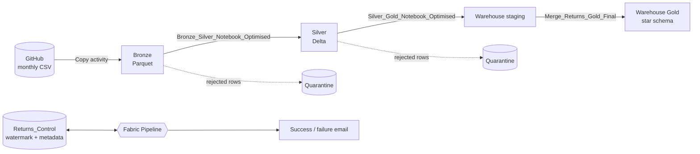
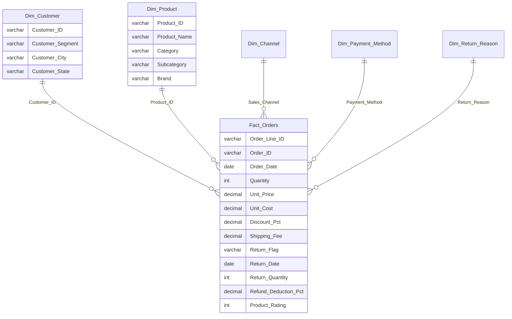

# Incremental Returns Analytics Lakehouse on Microsoft Fabric


An end-to-end, month-by-month data pipeline on Microsoft Fabric. It loads e-commerce order and returns files from GitHub, cleans and validates them through a **Bronze → Silver → Gold** medallion architecture, and publishes a star schema in a Fabric Warehouse for returns and refund analysis. Bad rows are quarantined with reasons, every run is audited, and success or failure is emailed without Microsoft 365.

**Author:** Adarsh Damarla
**Platform:** Microsoft Fabric (Lakehouse, Warehouse, Data Pipeline, Notebooks)
**Status:** Complete for the 2025 dataset (12 monthly files)

## Table of Contents

- [Project Highlights](#project-highlights)
- [Architecture](#architecture)
- [Data Flow](#data-flow)
- [Dimensional Model](#dimensional-model)
- [Implemented Fabric Resources](#implemented-fabric-resources)
- [Project Structure](#project-structure)
- [Running the Pipeline](#running-the-pipeline)
- [Engineering Decisions](#engineering-decisions)
- [Fault Tolerance](#fault-tolerance)
- [Challenges Solved](#challenges-solved)
- [Validation](#validation)
- [Documentation](#documentation)
- [Technology Stack](#technology-stack)
- [Scope and Future Evolution](#scope-and-future-evolution)
- [Author](#author)

## Project Highlights

- **Incremental by month.** A watermark table tracks the last month loaded; each run picks up the next month automatically, and any month can be reprocessed through pipeline parameters.
- **Medallion architecture.** Raw Parquet in Bronze, validated Delta in Silver, a star schema in the Warehouse.
- **Quarantine, not rejection.** Rows that break a rule are written to a quarantine location with every failed rule listed, and the rest of the month still loads.
- **Idempotent loads.** Silver and Gold are upserts on `Order_Line_ID`; staging and quarantine are overwritten, so reruns never duplicate data.
- **All-or-nothing Gold merge.** The six Gold merges run in one transaction and roll back on any error.
- **Run auditing.** Every run writes row counts, duration, status and error text to `Returns_Control.Pipeline_Metadata`.
- **Email alerts without Microsoft 365.** A Fabric Web activity posts the result to a Google Apps Script web app, which sends a `[SUCCEEDED]` or `[FAILED]` email.

## Architecture



The pipeline is the single orchestrator: it decides which month to load from the watermark, runs each stage in order, records the outcome, and sends the email. Processing is batch, one month per run. Full activity-by-activity detail is in the [architecture document](docs/PIPELINE_ARCHITECTURE.md).

## Data Flow

| Layer | Location | Format | Processing | Purpose |
|---|---|---|---|---|
| Source | `Data/*.csv` on GitHub | CSV | None | One file per month, one row per order line |
| Bronze | Lakehouse `Files/bronze/ecommerce_returns/year=/month=/` | Parquet (snappy) | Copy activity over HTTP | Raw copy of the month |
| Silver | Lakehouse `Files/silver/ecommerce_returns/` | Delta, partitioned by year and month | Type casting, standardization, validation, upsert | Clean, typed order lines |
| Quarantine | Lakehouse `Files/quarantine/ecommerce_returns/` | Delta | Rows that failed a rule, with reasons | Review and reprocess |
| Staging | Warehouse `Returns_Staging` | `*_stg` tables | Overwritten each run, row counts verified | Landing area for the merge |
| Gold | Warehouse `Returns_Gold` | Tables | Transactional MERGE | Star schema for reporting |
| Control | Warehouse `Returns_Control` | Tables | Watermark and run log | Incremental loading and audit |
| Notebook audit | Lakehouse table `notebook_audit` | Delta | One row appended per notebook run | Row counts and status per layer |

## Dimensional Model



`Fact_Orders` has one row per order line. The model joins on natural business keys, with no surrogate keys. `Dim_Product` and `Dim_Customer` are **Type 1**: a changed attribute overwrites the old value. `Dim_Channel`, `Dim_Payment_Method` and `Dim_Return_Reason` are single-column lookup lists that only receive new values.

## Implemented Fabric Resources

| Item | Name | Purpose |
|---|---|---|
| Lakehouse | `Ecommerce_Returns_Lakehouse` | Bronze, Silver and quarantine files |
| Warehouse | `Ecommerce_Returns_Warehouse` | Staging, Gold and control schemas |
| Data pipeline | `Ecommerce_Returns_Pipeline` | Orchestration, watermark, error handling, email |
| Notebook | `Bronze_Silver_Notebook_Optimised` | Clean, validate and merge into Silver |
| Notebook | `Silver_Gold_Notebook_Optimised` | Validate, build facts and dimensions, load staging |
| Stored procedure | `Returns_Staging.Merge_Returns_Gold_Final` | Transactional merge into Gold |
| Stored procedure | `Returns_Control.Update_Watermark` | Moves the watermark forward only |
| Stored procedure | `Returns_Control.Insert_Pipeline_Metadata` | Writes the run log |
| Connection | HTTP (GitHub raw) | Source of the monthly files |
| Connection | Web v2 (Apps Script) | Sends the email |

## Project Structure

```
.
├── README.md
├── Warehouse_Setup/                    Numbered T-SQL scripts to build the warehouse objects
├── apps_script/
│   └── Code.gs                         Google Apps Script that sends the pipeline emails
├── LICENSE                             MIT
├── docs/
│   ├── PIPELINE_ARCHITECTURE.md        Activities, layers, watermark logic, repo layout
│   ├── BUSINESS_RULES.md               Cleaning, validation, quarantine and merge rules
│   └── EMAIL_NOTIFICATIONS.md          Web activity + Apps Script email setup
├── Data/
│   └── Ecommerce_Returns_Refunds_2025_01_January.csv ... _2025_12_December.csv
└── Fabric_Ecommerce_Return_Analysis/   Fabric Git integration root
    ├── Ecommerce_Returns_Lakehouse.Lakehouse/
    ├── Ecommerce_Returns_Pipeline.DataPipeline/
    │   └── pipeline-content.json       All activities, variables, parameters
    ├── Notebooks/
    │   ├── Bronze_Silver_Notebook_Optimised.Notebook/   Used by the pipeline
    │   ├── Silver_Gold_Notebook_Optimised.Notebook/     Used by the pipeline
    │   ├── Bronze_Silver_Notebook.Notebook/             Earlier version, not used
    │   └── Silver_Gold_Notebook.Notebook/               Earlier version, not used
    └── Ecommerce_Returns_Warehouse.Warehouse/
        ├── Returns_Control/            Watermark + metadata tables and procedures
        ├── Returns_Staging/            *_stg tables and the Gold merge procedure
        ├── Returns_Gold/               Fact and dimension tables
        └── Security/                   Schema definitions
```

## Running the Pipeline

**Normal run (next month automatically):** run or schedule `Ecommerce_Returns_Pipeline` with both parameters empty.

**Reprocess a specific month:** set both `reprocess_year` and `reprocess_month`, for example `2025` and `3`. Set both or neither: if only one is set, both are ignored. The watermark never moves backwards, so reprocessing an older month does not disturb it.

**First run:** build the warehouse objects with the numbered scripts in [`Warehouse_Setup`](Warehouse_Setup/README.md) (schemas, tables, procedures and the starting watermark), then run the pipeline. Further steps are in the [architecture document](docs/PIPELINE_ARCHITECTURE.md#setup-notes).

**Source data:** one CSV per month named `Ecommerce_Returns_Refunds_<YYYY>_<MM>_<MonthName>.csv`. Amounts carry a rupee sign and thousands separators (`₹3,355.27`) and dates use `dd-MMM-yyyy`; the Silver notebook normalizes both.

## Engineering Decisions

### Why a watermark instead of a schedule-based date?
The source is a monthly file, and the right month to load depends on what has already succeeded, not on the calendar. The watermark moves only after the Gold merge succeeds, so a failed run retries the same month on the next run.

### Why quarantine bad rows instead of failing the run?
One malformed row should not block a whole month of good data. Each rejected row keeps its original values and the full list of failed rules, so it can be fixed at the source and reprocessed. Only structural problems (missing file, missing required columns, invalid parameters) fail a run.

### Why validate twice (Bronze to Silver, then Silver to Gold)?
The first pass cleans raw text and enforces data quality. The second protects the warehouse: it re-checks the fields reporting depends on, builds the dimensions, and confirms staging row counts before anything reaches Gold.

### Why staging tables and a MERGE into Gold?
Staging is overwritten each run and verified by row count, so Gold only ever receives a checked batch. The MERGE makes reruns safe, and wrapping the six merges in one transaction means Gold is either fully updated or unchanged.

### Why Delta files for Silver instead of loading straight to the Warehouse?
Delta gives upserts, schema handling and partitioning by year and month in the Lakehouse, and keeps a re-readable history of cleaned data that does not depend on the Warehouse being available.

### Why Google Apps Script for email?
The built-in Office 365 Outlook activity needs a Microsoft 365 mailbox. A Web activity calling an Apps Script web app sends the same alerts from a free Gmail account, with no extra Azure resources.

## Fault Tolerance

| Situation | Behaviour |
|---|---|
| Bad rows (invalid IDs, dates, amounts, values, rule breaks) | Quarantined with the reasons; the rest of the month loads |
| Missing or new columns in the source file | Missing columns are filled with NULL (and quarantined if mandatory); new columns are flagged as schema drift instead of breaking the load |
| Empty Bronze month | The notebook exits cleanly with 0 rows |
| Duplicate rows or duplicate `Order_Line_ID` values | Exact duplicates removed; extra keys quarantined so merges never fail on duplicate keys |
| Temporary failure of a stage | Main activities retry once after 30 seconds |
| A stage that still fails | The error is captured, the run is logged to `Pipeline_Metadata`, an email is sent, and the pipeline fails with the real error |
| Failure during the Gold merge | The six merges run in a single transaction, so Gold is either fully updated or left unchanged |
| Failed or partial run | The watermark moves only after the Gold merge succeeds, so the next run retries the same month |
| Rerunning a month | Safe: Silver and Gold are upserts on `Order_Line_ID`; staging and quarantine are overwritten |
| Staging write problems | Each staging table is read back and its row count checked before the merge |

It does not recover by itself once the retry is used up: a failed stage stops the run and needs a fix and a rerun. A missing source file also counts as a failure and sends the alert.

## Challenges Solved

| Challenge | Solution |
|---|---|
| Amounts like `₹3,355.27` and dates like `27-Jan-2025` arrive as text | Strip non-numeric characters, cast to decimals, parse `dd-MMM-yyyy` explicitly |
| Inconsistent labels (`UPI`, `wallet`, `COD`, `Not As Expected`) | Standardize case and map known variants before validating against allowed values |
| Returns data that contradicts itself (a return date on a non-returned order, return quantity above quantity) | Cross-field rules tie `Return_Flag`, `Return_Date`, `Return_Reason` and quantities together |
| The same `Order_Line_ID` appearing twice breaks a MERGE | Keep the best row per key and quarantine the rest before the merge |
| Source columns added or removed between files | Fill missing columns with NULL, flag new ones as schema drift, quarantine rows that carry values in them |
| Reruns must not duplicate data | Upserts on the business key; overwrite for staging and quarantine |
| A failure halfway through the Gold merge | One transaction with rollback, and the error re-raised to the pipeline |
| Knowing what happened in each run | Per-stage error messages and a metadata row for every run |
| No Microsoft 365 for pipeline email | Web activity + Google Apps Script, with Gmail filters for labelling |
| A next month that has no file yet | Detected as `No Source File`; watermark not advanced |

## Validation

- **Per-run audit:** every run adds a row to `Returns_Control.Pipeline_Metadata` with Bronze, Silver, Gold-staging and Gold-final row counts, duration and status.
- **Notebook audit:** each notebook appends a row to the Lakehouse table `notebook_audit` with its input, valid, quarantined and written row counts, inserted/updated counts, status and duration. Pass `@pipeline().RunId` as `p_run_id` to join it to `Pipeline_Metadata`.
- **Staging read-back:** each `*_stg` table is counted after writing and compared with the expected count.
- **Quarantine summary:** the notebooks print the number of rejected rows and a count per failed rule.
- **Email:** the success email carries the processed month and row counts; the failure email carries the error text.

Example check of recent runs:

```sql
SELECT TOP 12
    Process_Year, Process_Month_Name, Load_Status,
    Bronze_Record_Processed, Silver_Record_Processed,
    Gold_Fact_Stg_Record_Processed, Gold_Fact_Final_Record_Count,
    Duration_Seconds, Error_Message
FROM Returns_Control.Pipeline_Metadata
ORDER BY Start_Time DESC;
```

## Documentation

| Document | What it covers |
|---|---|
| [Pipeline architecture and project structure](docs/PIPELINE_ARCHITECTURE.md) | Every activity, data layers, watermark logic, warehouse design, error handling, setup notes |
| [Business rules](docs/BUSINESS_RULES.md) | Cleaning, validation, quarantine, Gold merge, run status rules and allowed values |
| [Email notifications](docs/EMAIL_NOTIFICATIONS.md) | Web activity and Apps Script setup, Gmail filters, troubleshooting |

## Technology Stack


## Scope and Future Evolution

This project covers ingestion, transformation, modelling, data quality, orchestration, auditing and alerting for a single monthly dataset. The natural next step is a Power BI semantic model and report on top of the Gold schema.

## License

Released under the [MIT License](LICENSE).

## Author

**Adarsh Damarla**
GitHub: [AdarshDamarla-DataEngineer-Git](https://github.com/AdarshDamarla-DataEngineer-Git)
