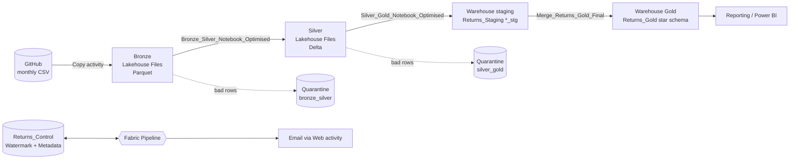
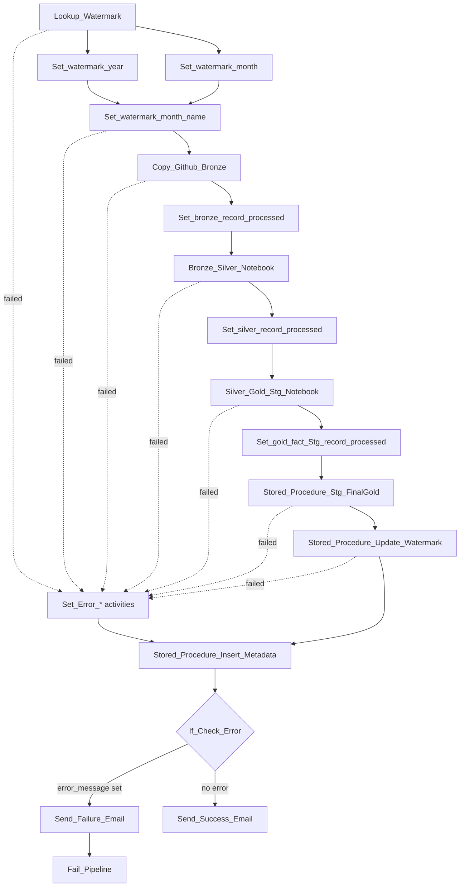

# Pipeline Architecture and Project Structure

## Contents

1. [Architecture overview](#architecture-overview)
2. [Pipeline flow](#pipeline-flow)
3. [Activity reference](#activity-reference)
4. [Watermark logic](#watermark-logic)
5. [Data layers](#data-layers)
6. [Warehouse design](#warehouse-design)
7. [Error handling and logging](#error-handling-and-logging)
8. [Project structure](#project-structure)
9. [Setup notes](#setup-notes)

## Architecture overview



| Layer | Location | Format | Purpose |
|---|---|---|---|
| Source | `Data/*.csv` in GitHub | CSV | One file per month |
| Bronze | Lakehouse `Files/bronze/ecommerce_returns/year=YYYY/month=MM/` | Parquet (snappy) | Raw copy of the month |
| Silver | Lakehouse `Files/silver/ecommerce_returns/` | Delta, partitioned by `Order_Year`, `Order_Month` | Cleaned, typed, validated order lines |
| Quarantine | Lakehouse `Files/quarantine/ecommerce_returns/{bronze_silver,silver_gold}/year=YYYY/month=MM/` | Delta | Rejected rows with the reasons |
| Staging | Warehouse schema `Returns_Staging` | Tables `*_stg` | Overwritten each run with the month's facts and dimensions |
| Gold | Warehouse schema `Returns_Gold` | Tables | Star schema, upserted |
| Control | Warehouse schema `Returns_Control` | Tables | Watermark and run metadata |

## Pipeline flow

The pipeline is `Ecommerce_Returns_Pipeline`. It runs with concurrency 1, so two runs never overlap.



The "Set_Error_*" activities and the metadata logging always run, so every run, successful or not, ends up in `Returns_Control.Pipeline_Metadata`.

## Activity reference

| Activity | Type | What it does |
|---|---|---|
| `Lookup_Watermark` | Lookup (Warehouse) | Reads the latest `Last_Processed_Year` and `Last_Processed_Month` for this pipeline |
| `Set_watermark_year` / `Set_watermark_month` | Set variable | Compute the month to load: reprocess parameters if both are set, otherwise the month after the watermark (December rolls to January of the next year) |
| `Set_watermark_month_name` | Set variable | Builds the month name (for example `March`) used in the file name. Fails on an invalid reprocess input |
| `Copy_Github_Bronze` | Copy | Downloads `Ecommerce_Returns_Refunds_<YYYY>_<MM>_<MonthName>.csv` over HTTP and writes Parquet to the Bronze path |
| `Set_bronze_record_processed` | Set variable | Stores `rowsCopied` |
| `Bronze_Silver_Notebook` | Notebook | Runs `Bronze_Silver_Notebook_Optimised` with `p_year`, `p_month`. Returns the number of valid rows merged |
| `Set_silver_record_processed` | Set variable | Stores the notebook exit value |
| `Silver_Gold_Stg_Notebook` | Notebook | Runs `Silver_Gold_Notebook_Optimised`. Returns the number of fact rows staged |
| `Set_gold_fact_Stg_record_processed` | Set variable | Stores the notebook exit value |
| `Stored_Procedure_Stg_FinalGold` | Stored procedure | `Returns_Staging.Merge_Returns_Gold_Final` merges staging into Gold in one transaction |
| `Stored_Procedure_Update_Watermark` | Stored procedure | `Returns_Control.Update_Watermark` advances the watermark |
| `Set_Error_*` | Set variable | One per stage. Writes a readable message into `error_message` when that stage fails |
| `Stored_Procedure_Insert_Metadata` | Stored procedure | `Returns_Control.Insert_Pipeline_Metadata` logs the run |
| `If_Check_Error` | If condition | If `error_message` is not empty, send the failure email and fail the pipeline; otherwise send the success email |

Both notebooks run with the session tag `returns_load`, so the second notebook can reuse the Spark session started by the first. All main activities use a 15 minute timeout and 1 retry with a 30 second interval.

## Watermark logic

- `Returns_Control.Pipeline_Watermark` holds one row per pipeline name with the last month successfully loaded.
- The watermark moves only at the very end, after the Gold merge succeeds. A failed run leaves it unchanged, so the next run retries the same month.
- `Update_Watermark` only updates when the new month is later than the stored one (`year*100+month` comparison). Reprocessing an old month therefore never moves the watermark backwards.
- A missing source file (HTTP 404 / "not found") is reported as `Source file not found for <year>-<month>. Watermark not advanced.` and logged with status **No Source File**. This is the normal state when the next month has not been published yet.

## Data layers

### Bronze

The Copy activity reads the CSV (comma delimited, header row, quote and escape characters set) and writes Parquet with snappy compression into a year/month folder. Types are not enforced here; amounts such as `₹3,355.27` stay as text.

### Silver

`Bronze_Silver_Notebook_Optimised`:

1. Validates the `p_year` and `p_month` parameters.
2. Reads the Bronze month. A missing or unreadable path raises an error. An empty month exits with 0 rows.
3. Fills in any expected column that is missing from the source with NULL, and detects new unexpected columns (schema drift).
4. Removes exact duplicate rows, cleans and types the data, and runs the row-level validation rules.
5. Writes rejected rows to quarantine and merges valid rows into the Silver Delta table on `Order_Line_ID` (update matched, insert new). The first ever load creates the table partitioned by `Order_Year` and `Order_Month`.

Full rule list: [BUSINESS_RULES.md](BUSINESS_RULES.md).

### Gold (staging then final)

`Silver_Gold_Notebook_Optimised` reads the month from Silver, validates it, splits it into one fact and five dimension data frames and overwrites the matching `*_stg` tables in the Warehouse. After each write it reads the table back and compares the row count with the expected count; a mismatch fails the notebook. `Merge_Returns_Gold_Final` then upserts the staging tables into Gold inside a single transaction (all-or-nothing, rolled back on error).

## Warehouse design

Star schema in `Returns_Gold`:

| Table | Grain / key | Columns |
|---|---|---|
| `Fact_Orders` | One row per order line, key `Order_Line_ID` | Order, customer, product, channel and payment references, `Quantity`, `Unit_Price`, `Unit_Cost`, `Discount_Pct`, `Shipping_Fee`, `Delivery_Date`, return fields (`Return_Flag`, `Return_Date`, `Return_Reason`, `Return_Quantity`, `Refund_Deduction_Pct`), `Product_Rating`, `Order_Year`, `Order_Month` |
| `Dim_Product` | `Product_ID` | `Product_Name`, `Category`, `Subcategory`, `Brand` |
| `Dim_Customer` | `Customer_ID` | `Customer_Segment`, `Customer_City`, `Customer_State` |
| `Dim_Channel` | `Sales_Channel` | |
| `Dim_Payment_Method` | `Payment_Method` | |
| `Dim_Return_Reason` | `Return_Reason` | |

The model uses natural business keys (no surrogate keys) and joins on those values. `Returns_Staging` mirrors each table with a `_stg` suffix.

`Returns_Control`:

| Table / procedure | Purpose |
|---|---|
| `Pipeline_Watermark` | Last processed year and month, last successful run ID, last updated time |
| `Pipeline_Metadata` | One row per run: name, run ID, trigger type, processed year/month and month name, source file name, Bronze / Silver / Gold-staging / Gold-final row counts, start and end time, duration in seconds, load status, error message |
| `Update_Watermark` | Moves the watermark forward only |
| `Insert_Pipeline_Metadata` | Writes the run log. Idempotent on `Pipeline_Run_ID`, so a retry does not create a second row. Accepts error text up to 8,000 characters and stores the first 2,000, so a long error cannot make logging fail |

## Error handling and logging

- Every stage has its own `Set_Error_*` activity that runs on failure and stores a message such as `Bronze_Silver_Notebook Failed: <error>`.
- `Insert_Pipeline_Metadata` runs whether the stages succeeded or failed, and derives the status: **Success**, **No Source File**, or **Failed**.
- `If_Check_Error` then decides the outcome. It runs after the logging step **completes** (succeeded or failed), so an email is sent even if logging fails. On error it emails and fails the pipeline with the code `PIPELINE_STAGE_FAILED`, so the run shows as failed in Fabric Monitor. Otherwise it emails a success summary.
- Row-level problems are not pipeline failures. They are quarantined and the run continues; the quarantined count is printed in the notebook output.
- Pipeline and structural problems (missing Silver table, missing required Silver column, staging row-count mismatch, invalid parameters) raise errors and fail the stage.

Email setup: [EMAIL_NOTIFICATIONS.md](EMAIL_NOTIFICATIONS.md).

## Project structure

```
Fabric-Ecommerce-Return-Analytics/
├── README.md                                  Project overview
├── Warehouse_Setup/                           Numbered T-SQL scripts (schemas, tables, procedures, watermark seed, reset)
├── docs/
│   ├── PIPELINE_ARCHITECTURE.md               This file
│   ├── BUSINESS_RULES.md                      Cleaning, validation and merge rules
│   └── EMAIL_NOTIFICATIONS.md                 Success/failure email setup
├── Data/
│   └── Ecommerce_Returns_Refunds_2025_01_January.csv ... _2025_12_December.csv
└── Fabric_Ecommerce_Return_Analysis/          Fabric Git integration root
    ├── Readme.md                              Auto-created by Fabric
    ├── Ecommerce_Returns_Lakehouse.Lakehouse/ Lakehouse definition
    ├── Ecommerce_Returns_Pipeline.DataPipeline/
    │   ├── .platform
    │   └── pipeline-content.json              All activities, variables and parameters
    ├── Notebooks/
    │   ├── Bronze_Silver_Notebook_Optimised.Notebook/   Used by the pipeline
    │   ├── Silver_Gold_Notebook_Optimised.Notebook/     Used by the pipeline
    │   ├── Bronze_Silver_Notebook.Notebook/             Earlier, simpler version (not used by the pipeline)
    │   └── Silver_Gold_Notebook.Notebook/               Earlier, simpler version (not used by the pipeline)
    └── Ecommerce_Returns_Warehouse.Warehouse/
        ├── Ecommerce_Returns_Warehouse.sqlproj
        ├── Security/                          Schema definitions
        ├── Returns_Control/
        │   ├── Tables/                        Pipeline_Watermark, Pipeline_Metadata
        │   └── StoredProcedures/              Update_Watermark, Insert_Pipeline_Metadata
        ├── Returns_Staging/
        │   ├── Tables/                        Fact_Orders_stg, Dim_*_stg
        │   └── StoredProcedures/              Merge_Returns_Gold_Final
        └── Returns_Gold/
            └── Tables/                        Fact_Orders, Dim_Product, Dim_Customer,
                                               Dim_Channel, Dim_Payment_Method, Dim_Return_Reason
```

The pipeline references the Optimised notebooks by ID. The two earlier notebooks are kept for comparison and are not run.

## Setup notes

1. Create the workspace items from this repo (Fabric Git integration or manual import): Lakehouse, Warehouse, notebooks, pipeline.
2. Set the default Lakehouse on both notebooks to `Ecommerce_Returns_Lakehouse`.
3. In the pipeline, recreate the connections: the HTTP connection used by the Copy activity (base URL `https://raw.githubusercontent.com/<github-user>/`; the activity appends `Fabric-Ecommerce-Return-Analytics/refs/heads/main/Data/<file>.csv`, so the source files are read from the `main` branch of that repository), the Lakehouse and Warehouse references, and the email Web connection (see the email guide).
4. Build the warehouse objects by running the scripts in [`Warehouse_Setup`](../Warehouse_Setup/README.md) in order. `05_Seed_Watermark.sql` creates the starting watermark row: set it to the month **before** the first month to load (for January 2025, that is 2024 and 12).

5. Run the pipeline. Each run loads one month; schedule it to run on the cadence you want.
