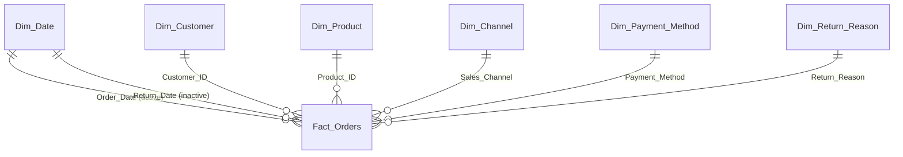

# Semantic Model

Reference for `Ecommerce_Returns_Semantic_Model`, the Power BI semantic model built on the Gold star schema. The report that uses it is described in [POWER_BI_REPORT.md](POWER_BI_REPORT.md).

## Contents

1. [Overview](#1-overview)
2. [Storage mode and refresh](#2-storage-mode-and-refresh)
3. [Tables](#3-tables)
4. [Relationships](#4-relationships)
5. [Measures](#5-measures)
6. [Design notes](#6-design-notes)
7. [Repository files](#7-repository-files)
8. [Setup and maintenance](#8-setup-and-maintenance)

## 1. Overview

| Item | Value |
|---|---|
| Name | `Ecommerce_Returns_Semantic_Model` |
| Source | `Returns_Gold` schema of `Ecommerce_Returns_Warehouse` |
| Storage mode | Direct Lake (on OneLake) |
| Tables | 1 fact, 5 dimensions, 1 calendar |
| Measures | 25, all on `Fact_Orders`, in 5 display folders |
| Currency | Rupee (`"₹"`), matching the source data |
| Culture | `en-US` |

## 2. Storage mode and refresh

Every table uses **Direct Lake** storage mode. The model has one shared source expression, `DirectLake - Ecommerce_Returns_Warehouse`, which points at the warehouse through OneLake. No data is imported or copied into the model.

- **Refresh.** `Ecommerce_Returns_Pipeline` runs the `Ecommerce_Returns_Sematic_Model` activity after the watermark is updated (20 minute timeout, 1 retry, waits for completion). For a Direct Lake model a refresh reframes the model onto the latest Delta data, so it is quick. The activity name is spelled this way in the pipeline.
- **Failure behaviour.** The refresh runs after Gold and the watermark are updated. If it fails, the run is logged and emailed as failed, but the data is not rolled back. Refresh the model manually in the Fabric workspace to catch up.
- **Scope.** Only the Gold tables are in the model. The control tables (`Pipeline_Watermark`, `Pipeline_Metadata`) and the staging tables (`*_stg`) were removed from it on purpose.

## 3. Tables

All tables read from `Returns_Gold`. Column names with an underscore in the warehouse are shown with spaces in a few places in the model (see the calendar).

| Table | Rows represent | Columns | Notes |
|---|---|---|---|
| `Fact_Orders` | One order line (key `Order_Line_ID`) | Order, customer, product, channel and payment references; `Quantity`, `Unit_Price`, `Unit_Cost`, `Discount_Pct`, `Shipping_Fee`; `Order_Date`, `Delivery_Date`; return fields (`Return_Flag`, `Return_Date`, `Return_Reason`, `Return_Quantity`, `Refund_Deduction_Pct`); `Product_Rating`; `Order_Year`, `Order_Month` | Holds all measures |
| `Dim_Customer` | One customer | `Customer_ID`, `Customer_Segment`, `Customer_City`, `Customer_State` | |
| `Dim_Product` | One product | `Product_ID`, `Product_Name`, `Category`, `Subcategory`, `Brand` | |
| `Dim_Channel` | One sales channel | `Sales_Channel` | |
| `Dim_Payment_Method` | One payment method | `Payment_Method` | |
| `Dim_Return_Reason` | One return reason | `Return_Reason` | |
| `Dim_Date` | One calendar day, 2020-01-01 to 2035-12-31 | `Date`, `Year`, `Month Number`, `Month`, `Year Month` | Marked as the date table (`Date` is the key); `Month` sorts by `Month Number` |

**Hidden columns.** The five foreign-key columns on `Fact_Orders` (`Customer_ID`, `Product_ID`, `Sales_Channel`, `Payment_Method`, `Return_Reason`) are hidden, so report authors use the dimension columns instead.

**Summarization.** Key and text columns are set to *Do not summarize*, so dragging one into a visual never produces an accidental sum. Use the measures for all numbers.

`Dim_Date` is created once by [`Warehouse_Setup/10_Create_Dim_Date.sql`](../Warehouse_Setup/10_Create_Dim_Date.sql) and is not loaded by the pipeline. Order and return dates outside 2020 to 2035 have no matching calendar row.

## 4. Relationships

Seven relationships join `Fact_Orders` to the dimensions on the natural business keys (the Gold schema has no surrogate keys).

| From (`Fact_Orders`) | To | Active |
|---|---|---|
| `Customer_ID` | `Dim_Customer[Customer_ID]` | Yes |
| `Product_ID` | `Dim_Product[Product_ID]` | Yes |
| `Sales_Channel` | `Dim_Channel[Sales_Channel]` | Yes |
| `Payment_Method` | `Dim_Payment_Method[Payment_Method]` | Yes |
| `Return_Reason` | `Dim_Return_Reason[Return_Reason]` | Yes |
| `Order_Date` | `Dim_Date[Date]` | Yes |
| `Return_Date` | `Dim_Date[Date]` | **No** |

The two date relationships are role-playing: a visual filtered by month uses `Order_Date` by default. A measure that needs the return date activates the second relationship with `USERELATIONSHIP` (see `Refund Amount by Return Date`). The model file defines no cardinality or filter direction, so Power BI's defaults apply: many-to-one from the fact to each dimension, filtering from the dimension to the fact.

## 5. Measures

All measures are on `Fact_Orders`. Implicit measures are discouraged in the model settings, so reports use these instead of summing columns.

### Volume

| Measure | Definition | Format |
|---|---|---|
| Order Lines | `COUNTROWS(Fact_Orders)` | `#,0` |
| Orders | `DISTINCTCOUNT(Order_ID)` | `#,0` |
| Units Sold | `SUM(Quantity)` | `#,0` |
| Customers | `DISTINCTCOUNT(Customer_ID)` | `#,0` |

### Sales

| Measure | Definition | Format |
|---|---|---|
| Gross Sales | `SUMX(Quantity * Unit_Price)` | ₹ |
| Discount Amount | `SUMX(Quantity * Unit_Price * Discount_Pct / 100)` | ₹ |
| Net Sales | `[Gross Sales] - [Discount Amount]` | ₹ |
| Shipping Fees | `SUM(Shipping_Fee)` | ₹ |
| Avg Order Value | `DIVIDE([Net Sales], [Orders])` | ₹ with 2 decimals |
| Net Sales Previous Month | `CALCULATE([Net Sales], DATEADD(Dim_Date[Date], -1, MONTH))` | ₹ |
| Net Sales MoM % | `DIVIDE([Net Sales] - [Net Sales Previous Month], [Net Sales Previous Month])` | 0.0% |

### Returns

| Measure | Definition | Format |
|---|---|---|
| Returned Lines | Order lines where `Return_Flag = "Yes"` | `#,0` |
| Returned Units | `SUM(Return_Quantity)` | `#,0` |
| Refund Amount | `SUMX(Return_Quantity * Unit_Price * (1 - Discount_Pct/100) * (1 - Refund_Deduction_Pct/100))` | ₹ |
| Refund Amount by Return Date | `[Refund Amount]` evaluated through the inactive `Return_Date` relationship | ₹ |
| Return Rate (Lines) | `DIVIDE([Returned Lines], [Order Lines])` | 0.0% |
| Return Rate (Units) | `DIVIDE([Returned Units], [Units Sold])` | 0.0% |
| Refund % of Net Sales | `DIVIDE([Refund Amount], [Net Sales])` | 0.0% |
| Avg Days to Return | Average of `Return_Date - Order_Date` in days, over lines with a return date | 0.0 |

### Profit

| Measure | Definition | Format |
|---|---|---|
| Net Sales After Returns | `[Net Sales] - [Refund Amount]` | ₹ |
| Cost of Kept Units | `SUMX((Quantity - Return_Quantity) * Unit_Cost)` (a blank return quantity counts as 0) | ₹ |
| Gross Profit | `[Net Sales After Returns] - [Cost of Kept Units]` | ₹ |
| Gross Margin % | `DIVIDE([Gross Profit], [Net Sales After Returns])` | 0.0% |

### Service

| Measure | Definition | Format |
|---|---|---|
| Avg Rating | `AVERAGE(Product_Rating)` | 0.00 |
| Avg Days to Deliver | Average of `Delivery_Date - Order_Date` in days, over lines with a delivery date | 0.0 |

## 6. Design notes

- **Refunds are priced as paid.** The refund starts from the unit price, removes the order discount, then removes the refund deduction. It does not use `Net Sales`, because only the returned units are refunded.
- **Two ways to date a refund.** `Refund Amount` follows the order month, which answers "how much of this month's sales came back". `Refund Amount by Return Date` follows the return month, which answers "how much was refunded this month". The Overview line chart uses the second so the two lines can be compared by calendar month.
- **Rates come in two flavours.** `Return Rate (Lines)` counts order lines and is the one the report highlights. `Return Rate (Units)` weights by quantity.
- **Profit is after returns.** Gross Profit removes refunds and the cost of kept units only. Shipping fees are not included in cost or revenue.
- **Month-on-month needs the calendar.** `Net Sales MoM %` relies on `Dim_Date[Date]` being a continuous date column and a month (or year-month) in the filter context.

## 7. Repository files

The model is stored in TMDL under `Fabric_Ecommerce_Return_Analysis/Ecommerce_Returns_Semantic_Model.SemanticModel/`:

| File | Content |
|---|---|
| `definition.pbism` | Model definition properties |
| `definition/database.tmdl` | Compatibility level |
| `definition/model.tmdl` | Model settings, query order and the list of tables |
| `definition/expressions.tmdl` | The `DirectLake - Ecommerce_Returns_Warehouse` source expression and the tables removed from the model |
| `definition/relationships.tmdl` | The seven relationships |
| `definition/tables/*.tmdl` | One file per table: columns, measures (in `Fact_Orders.tmdl`) and the Direct Lake partition |
| `.platform` | Fabric item metadata |

## 8. Setup and maintenance

1. Build the warehouse objects with the scripts in [`Warehouse_Setup`](../Warehouse_Setup/README.md), including `10_Create_Dim_Date.sql`.
2. Sync the Fabric Git integration so the model appears in the workspace, then confirm its Direct Lake source points at your `Ecommerce_Returns_Warehouse`.
3. In the pipeline, select the model and a Power BI connection in the refresh activity.
4. Run the pipeline. The first successful run loads Gold and refreshes the model.

To change the model, edit it in the Fabric workspace (web modelling) or open the TMDL folder in Power BI Desktop developer mode, then commit through Git integration. When the Gold schema changes (a new column or table), update the model to match: Direct Lake does not pick up new columns automatically.
